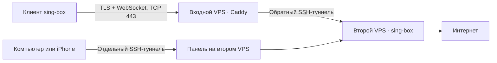

# Traveler на двух VPS. Установка, телефон и обслуживание

Этот гайд начинается с двух чистых VPS и заканчивается работающим подключением к интернету через Traveler. В закрытой веб-панели администратор создаёт пользователей и выдаёт отдельный профиль на каждое их устройство.

## 1. Как проходит трафик



- **Входной VPS** принимает клиентские подключения. Caddy завершает внешний TLS, обслуживает обычную страницу и отправляет WebSocket-запросы по выделенному маршруту.
- **Второй VPS** запускает sing-box на `127.0.0.1:10000` и выходит в интернет от своего имени. Он сам открывает обратное SSH-соединение к входному VPS. На входе порт этого соединения `18443` привязан к loopback.
- **Панель** работает на Unix-сокете на втором VPS. Для выделенных SSH-учётных записей компьютера и iPhone есть мост `127.0.0.1:18765`. Эти учётные записи могут пробрасывать только порт панели, без доступа к командной строке VPS.
- Входной VPS остаётся доверенной частью схемы, потому что завершает внешний TLS. HTTPS-сессии приложений с конечными сайтами сохраняют собственное шифрование. Доступность сети и её отношение к этому трафику проверяйте с реального клиентского подключения.

## 2. Что подготовить

| Где | Что нужно |
| --- | --- |
| Оба VPS | Ubuntu 24.04 LTS x86-64, systemd, публичный IPv4, доступ root по SSH с ключом |
| Входной VPS | Входящий TCP/443 и SSH. Для режима с доменом разрешите также TCP/80 |
| Второй VPS | Входящий SSH для администрирования и, при необходимости, для телефона. Исходящий SSH к входному VPS и обычный доступ в интернет |
| Компьютер | Python 3.10+, Git и OpenSSH. На Windows команды запускаются в PowerShell |
| iPhone | sing-box для VPN. Для веб-панели отдельно нужен SSH-клиент с локальным пробросом |

Для первой установки используйте чистые VPS. Установщик допускает стандартный Caddyfile из пакета Ubuntu или свой ранее созданный файл с отметкой Traveler. Пользовательский Caddyfile требует ручного объединения маршрутов. Команды далее используют адреса для примеров, подставьте свои.

| Пример | Значение |
| --- | --- |
| `203.0.113.10` | Публичный IPv4 входного VPS |
| `198.51.100.20` | Публичный IPv4 второго VPS |
| `vpn.example.com` | Необязательное имя входа |
| `22` | Пример порта SSH на каждом VPS |

### Подготовьте ключ администратора

Если у вас уже есть рабочий SSH-ключ с доступом root к обоим VPS, используйте его. Иначе создайте его на компьютере. На запрос о пароле ключа можно ввести фразу и загрузить ключ в SSH-agent перед запуском установщика.

```powershell
New-Item -ItemType Directory -Force "$env:USERPROFILE/.ssh" | Out-Null
ssh-keygen -t ed25519 -f "$env:USERPROFILE/.ssh/traveler-admin" -C traveler-admin
Get-Content "$env:USERPROFILE/.ssh/traveler-admin.pub"
```

Добавьте строку из файла `.pub` в `/root/.ssh/authorized_keys` на обоих VPS через консоль хостинга или уже существующую сессию. Если файл создаётся впервые, выполните на каждом VPS.

```bash
install -d -m 700 /root/.ssh
touch /root/.ssh/authorized_keys
chmod 600 /root/.ssh/authorized_keys
nano /root/.ssh/authorized_keys
```

При первом подключении сверьте отпечаток с выводом команды на консоли каждого VPS. Подтвердите ключ хоста в клиенте только при совпадении. Установщик пользуется этим ранее подтверждённым ключом из `known_hosts`.

```bash
ssh-keygen -lf /etc/ssh/ssh_host_ed25519_key.pub
```

```powershell
$admin = "$env:USERPROFILE/.ssh/traveler-admin"
ssh -i $admin root@203.0.113.10 "id -u"
ssh -i $admin root@198.51.100.20 "id -u"
```

Обе проверки должны вывести `0`. Установщик использует неинтерактивный SSH. Для ключа с паролем заранее настройте SSH-agent. Если хост уже переустанавливали, сначала сверьте новый отпечаток с консолью VPS, затем обновите запись в `known_hosts`.

### Выберите адрес для клиентских профилей

- **По IP.** Домен не требуется. Caddy выпускает сертификат внутренним CA, установщик передаёт открытый сертификат CA на второй VPS и включает его в экспортируемый JSON. sing-box продолжает проверять TLS. Поддержка этого CA ограничена профилем sing-box. Обычный браузер может предупредить о сертификате при открытии публичной страницы.
- **По домену.** Создайте запись A на IPv4 входного VPS. Для конфигурации этого гайда оставьте только один A и удалите AAAA у выбранного имени, если он указывает на другой сервер. Дождитесь обновления DNS. Caddy получит публичный сертификат автоматически при доступности ACME и TCP/80 или TCP/443. Платный SSL у регистратора для этой схемы не нужен.

Проверка DNS в PowerShell.

```powershell
Resolve-DnsName vpn.example.com -Type A
Resolve-DnsName vpn.example.com -Type AAAA
```

## 3. Установка с компьютера

```powershell
git clone https://github.com/smithishak/traveler-deploy.git
Set-Location traveler-deploy
$admin = "$env:USERPROFILE/.ssh/traveler-admin"
python split/install.py install --edge 203.0.113.10 --origin 198.51.100.20 --identity $admin
```

Для домена добавьте `--domain vpn.example.com`. Для публичного сайта с попарным голосованием добавьте `--site`. Сайт «Кинолица» хранит голоса в браузере. Установка без `--site` показывает на входе простую страницу Traveler. [Файлы, запуск и лицензии сайта](Кинолица.md)

```powershell
python split/install.py install --edge 203.0.113.10 --origin 198.51.100.20 --identity $admin --domain vpn.example.com --site
```

На Linux и macOS используйте `python3` и путь к ключу вроде `~/.ssh/traveler-admin`. Если SSH работает на другом порту, добавьте `--edge-port` и/или `--origin-port`. Если нужные публичные ключи панели уже готовы, передайте их при установке через `--panel-key ПУТЬ.pub` и `--iphone-key ПУТЬ.pub`.

Установщик проверяет SSH-доступ, ставит пакеты, проверяет контрольную сумму архива sing-box, создаёт профиль `traveler`, запускает обратный туннель и панель. Для статистики он собирает закреплённую версию sing-box с API счётчиков, если этот модуль ещё не установлен. На VPS с одним ядром первая сборка может занять 15 минут или больше. Оставьте не менее 3 ГБ свободного места для временных файлов. В конце установщик проверяет ответ панели, статистику, сертификат публичного входа и переключение HTTP на WebSocket. Проверьте также реальный выход в интернет с устройства по разделу 6.

Если установка оборвалась, исправьте ошибку из вывода и повторите ту же команду. Существующие конфигурация sing-box, пароль профиля, WebSocket-путь, ключ обратного туннеля и добавленные публичные ключи сохраняются. Установщик перезапускает панель и обратный туннель. На действующей установке запланируйте короткий перерыв в подключении. При переходе с IP на домен заново скачайте и импортируйте профили.

## 4. Панель на компьютере

Для быстрой первой проверки используйте доступ администратора.

```powershell
python split/install.py panel --origin 198.51.100.20 --identity $admin --admin
```

Оставьте команду запущенной и откройте [панель на этом компьютере](http://localhost:8765/). Локальный HTTP-запрос между браузером и SSH-клиентом остаётся на устройстве, дальше его шифрует SSH. `Ctrl+C` закрывает туннель.

Для повседневного управления удобно создать отдельный ключ с правом открывать только панель.

```powershell
$panelKey = "$env:USERPROFILE/.ssh/traveler-panel"
ssh-keygen -t ed25519 -f $panelKey -C traveler-desktop
python split/install.py add-key --origin 198.51.100.20 --identity $admin --kind desktop --public-key "$panelKey.pub"
python split/install.py panel --origin 198.51.100.20 --identity $panelKey
```

Можно открыть тот же туннель обычным OpenSSH. Укажите свой порт SSH, если он отличается от 22.

```bash
ssh -NT -o ExitOnForwardFailure=yes -o StrictHostKeyChecking=yes \
  -i ~/.ssh/traveler-panel -L 127.0.0.1:8765:127.0.0.1:18765 \
  traveler-panel-access@198.51.100.20
```

## 5. Панель с iPhone через Termius

На рабочей установке панель открылась в Safari после запуска отдельного правила **Local Forwarding** в Termius. Настройки бесплатного тарифа описаны на странице разработчика. [Termius для iOS](https://termius.com/download/ios) · [Тарифы Termius](https://termius.com/pricing)

### Добавьте ключ iPhone

1. В Termius откройте **Vaults → Keychain → ＋ → Generate Key**.
2. Выберите **Ed25519**, назовите ключ `Traveler iPhone` и сохраните.
3. Откройте ключ и выберите **Copy Public Key**. Перенесите на компьютер только строку `ssh-ed25519 …` и сохраните её в `traveler-iphone.pub`. Закрытый ключ хранится в приложении на телефоне.
4. С компьютера выполните команду ниже. Если публичный ключ уже был указан через `--iphone-key`, этот шаг выполнен установщиком.

```powershell
python split/install.py add-key --origin 198.51.100.20 --identity $admin --kind iphone --public-key ./traveler-iphone.pub
```

### Создайте хост и правило проброса

1. В **Vaults → Hosts → ＋** сохраните хост второго VPS. Используйте SSH-порт сервера, логин **`traveler-panel-ios`** и ключ **Traveler iPhone**.
2. В **Vaults → Port Forwarding → ＋** выберите **Local** и заполните поля из таблицы.
3. Сохраните правило галочкой и нажмите на его карточку, чтобы запустить. Сверьте отпечаток SSH-сервера с консолью VPS, если клиент его запросит.
4. Сразу переключитесь в Safari и откройте **`http://localhost:8765/`**. После работы можно остановить правило в Termius.

| Поле в Termius | Значение |
| --- | --- |
| Type | Local |
| Label | Traveler Panel |
| Local Port | `8765` |
| Bind Address | `127.0.0.1` |
| Intermediate Host | Сохранённый хост второго VPS с логином `traveler-panel-ios` |
| Destination address | `127.0.0.1` |
| Destination port number | `18765` |

Обычная карточка хоста в **Connections** открывает терминал. Для `traveler-panel-ios` shell закрыт, поэтому используйте карточку именно из **Port Forwarding**. После переключения в Safari iOS может приостановить Termius. Если страница перестала отвечать, вернитесь в Termius, проверьте состояние правила и при необходимости запустите его снова. При первых проверках удобнее делать это сразу после старта туннеля.

Перед изменением устройств на iPhone отключите VPN в sing-box и заново запустите правило Termius. Добавление, удаление и перевыпуск профилей перезапускают VPN-процесс и обрывают его активные соединения. Если Termius подключился через этот же VPN, Safari может показать `Load failed`, хотя устройство уже добавлено. Переподключите Termius напрямую, откройте список устройств и проверьте результат перед повторной выдачей. Включите VPN снова после работы с панелью.

Если у вас уже настроен другой SSH-клиент, его правило эквивалентно `-L 127.0.0.1:8765:127.0.0.1:18765`. Для WebSSH использовался формат `8765:127.0.0.1:18765`, однако встроенный браузер и HTTP Forge выдавали ошибку TLS на проверенном iPhone. Вариант с Dynamic Port Forwarding был проверен через OpenSSH, а на телефоне WebSSH предлагал его как платную функцию. В Pockterm список ключей показывал сокращённый публичный ключ без кнопки копирования. Практическая последовательность в этом гайде использует проверенный вход через Termius и Safari.

## 6. Выдайте профиль и проверьте VPN

1. Откройте панель через SSH. Коснитесь обложки, затем нажмите **«+ Пользователь»** и введите имя. Откройте его плитку, нажмите **«+ Устройство»**, введите название и выберите тип устройства. У каждого устройства свой пароль. Существующие до обновления профили появятся у пользователя **«Владелец»** с прежними паролями.
2. После добавления устройства панель сразу покажет **«Скачать JSON»** и **«Показать QR»**. Для импорта на том же iPhone скачайте JSON, сохраните файл в «Файлы» и выберите в sing-box **Profiles → ＋ → Import from File**. Для импорта с другого экрана покажите QR и откройте **Profiles → ＋ → Scan QR Code**. QR использует формат QRS и содержит полную локальную конфигурацию, включая сертификат в режиме по IP.
3. На других платформах импортируйте скачанный JSON в совместимый клиент sing-box. Приложение должно поддерживать поля TUN, Trojan/WebSocket и TLS из профиля. Для десктопного режима TUN могут понадобиться системные права.
4. Включите профиль, откройте несколько обычных сайтов и проверьте внешний IPv4. При этой схеме он должен совпасть с адресом второго VPS. Для отдельной проверки используйте мобильную сеть или другой Wi‑Fi.
5. Если устройство потеряно или профиль больше не нужен, выберите **«Удалить»** рядом с ним и подтвердите действие. Удаление пользователя отзывает все его профили. Изменения применяются с коротким перезапуском sing-box. Исходный профиль `traveler` защищён от удаления через панель. QR и JSON содержат действующие учётные данные и хранятся как пароль.

Панель подтверждает первое подключение, когда сборщик замечает трафик устройства. В карточке остаются точное время последней активности и полученные и отправленные байты. Если замеры остановились, сохранённые показания видны с отметкой об устаревании. Интервал опроса составляет примерно 15 секунд. История до включения учёта и даты создания старых профилей неизвестны. [Как собирается статистика](traffic.md)

Чтобы заменить выданный пароль, выберите **«Перевыпустить»** у устройства. После подтверждения скачайте новый JSON или покажите новый QR. Старый профиль теряет доступ. Название устройства, дата создания и счётчики сохраняются. При изменении пароля sing-box кратко перезапускается.

Проверка установщика до уровня WebSocket не использует пароль VPN. Проверка из этого раздела подтверждает клиентскую аутентификацию, работу маршрутизации и выход в интернет. По возможности также проверьте, что свежий сеанс после отзыва профиля отклоняется.

### Android TV и Google TV

Установите **sing-box for Android (SFA)**. Если приложение недоступно в магазине телевизора, скачайте официальный APK `SFA-…-universal.apk` из релиза и перенесите его на телевизор. Для каждого телевизора создайте отдельное устройство в панели и скачайте его JSON. [Клиент SFA](https://sing-box.sagernet.org/clients/android/) · [Официальные релизы](https://github.com/SagerNet/sing-box/releases)

Если **Profiles → + → Import from file** зависает до появления списка файлов, попробуйте открыть конфигурацию напрямую:

1. Сделайте копию скачанного профиля и замените расширение `.json` на `.bpf`, например `Traveler-TV.bpf`. Содержимое оставьте прежним.
2. Перенесите копию на телевизор, например на флешке. В файловом менеджере откройте **«Открыть с помощью»** для этого файла и выберите **sing-box**.
3. Подтвердите импорт и включите VPN. Откройте видео, затем проверьте в панели Traveler, появился ли трафик у профиля телевизора.

Обход с `.bpf` проверен на Haier Android TV PRO с SFA 1.14.4. Наличие sing-box в меню **«Открыть с помощью»** зависит от прошивки и файлового менеджера. Файл `.bpf` содержит те же учётные данные, что и исходный JSON.

## 7. Что проверить при ошибке

В **«Настройках»** нажмите **«Проверить маршрут»**. Панель отдельно покажет результат проверки сертификата входа, ответа WebSocket через туннель и HTTPS-запроса с авторизацией. Служебный профиль разрешает запросы только к тестовым адресам и не участвует в статистике устройств. Проверка идёт с основного VPS. Если сбой есть только на телефоне, проверьте подключение с его мобильной сети. Параметр установщика `--diagnostic-egress-ip` добавляет отдельную сверку ожидаемого выходного IPv4. Используйте его, если адрес выхода заранее известен.

| Симптом | Проверка |
| --- | --- |
| `Permission denied (publickey)` | Сверьте адрес VPS, логин и выбранный ключ. В Termius для панели нужен `traveler-panel-ios`, в обычном клиенте на компьютере — `traveler-panel-access`. |
| Приложение показывает пустой терминал | Запустите правило **Local Forwarding**. Мобильной учётной записи разрешено перенаправление порта. |
| Safari потерял соединение | Проверьте, активно ли правило в Termius. Укажите полный URL `http://localhost:8765/`. При сообщении о занятом порте остановите другой SSH-клиент, который использует 8765. |
| Браузер сообщает об ошибке TLS для панели | Проверьте схему `http://` и состояние проброса. Сайт по публичному адресу входного VPS, напротив, использует `https://`. |
| Установщик видит DNS-ошибку | Дождитесь, пока домен будет разрешаться только в IPv4 входного VPS. Можно начать с режима по IP и позже переключить адрес экспорта. |
| WebSocket возвращает 502 | Проверьте обратный SSH-туннель и наличие слушателя `127.0.0.1:18443` на входном VPS. |
| sing-box не проходит проверку TLS | Скачайте актуальный профиль. Сверьте имя входа и сертификат. Поле `insecure` в JSON должно быть `false`. |
| Внешний IP не совпадает со вторым VPS | Убедитесь, что запущен нужный профиль, устройство выдало разрешение на VPN, а клиент работает в TUN. |

На втором VPS.

```bash
systemctl is-active traveler-origin traveler-edge-link traveler-panel traveler-panel-ios.socket
journalctl -u traveler-edge-link -n 50 --no-pager
journalctl -u traveler-panel -u traveler-panel-ios.service -n 50 --no-pager
ss -ltn '( sport = :10000 or sport = :18765 )'
runuser -u traveler-panel-ios -- curl -fsS -o /dev/null -w '%{http_code}\n' \
  -H 'Host: localhost:8765' http://127.0.0.1:18765/
```

На входном VPS.

```bash
systemctl is-active caddy ssh
journalctl -u caddy -n 50 --no-pager
ss -ltn '( sport = :443 or sport = :18443 )'
sshd -t
```

Публично ожидается TCP/443 на входном VPS. Порты 10000, 18443 и 18765 должны слушать только на loopback соответствующего VPS. Для проверки чужой сети откройте с неё VPN и проверьте выход через второй VPS.

## 8. Копии, перенос и обновления

Сделайте закрытые резервные копии перед заменой VPS, обновлением системы или сертификата. Копия содержит секреты. Храните её зашифрованной и отдельно от репозитория.

| VPS | Что сохранить |
| --- | --- |
| Второй | `/etc/traveler-origin`, `/etc/traveler-panel`, `/var/lib/traveler-panel`, `/var/lib/traveler-panel-traffic`, `/var/lib/traveler-origin/.ssh`, файлы `authorized_keys` у `traveler-panel-access` и `traveler-panel-ios`, а также SSH-правила и unit-файлы Traveler |
| Входной | `/etc/caddy/Caddyfile`, каталог данных Caddy `/var/lib/caddy`, `/var/lib/traveler-link/.ssh/authorized_keys`, правило SSH для Traveler |

На втором VPS сохраните настройки, ключи и файлы сервисов в архив с доступом только для root.

```bash
umask 077
tar -C / -czf "/root/traveler-origin-$(date +%F).tar.gz" \
  etc/traveler-origin etc/traveler-panel opt/traveler-panel \
  var/lib/traveler-panel var/lib/traveler-panel-traffic \
  var/lib/traveler-origin/.ssh var/lib/traveler-panel-access/.ssh var/lib/traveler-panel-ios/.ssh \
  etc/ssh/sshd_config.d/60-traveler-panel.conf etc/ssh/sshd_config.d/61-traveler-panel-ios.conf \
  etc/systemd/system/traveler-origin.service etc/systemd/system/traveler-edge-link.service \
  etc/systemd/system/traveler-panel.service etc/systemd/system/traveler-panel-ios.service \
  etc/systemd/system/traveler-panel-ios-guard.service etc/systemd/system/traveler-panel-ios.socket \
  etc/systemd/system/traveler-panel-traffic.service usr/local/bin/traveler-sing-box
```

На входном VPS сохраните конфигурацию и данные Caddy. Если изменяли сайт на сервере, сохраните также `/srv/traveler-edge-site`.

```bash
umask 077
tar -C / -czf "/root/traveler-edge-$(date +%F).tar.gz" \
  etc/caddy/Caddyfile var/lib/caddy var/lib/traveler-link/.ssh \
  etc/ssh/sshd_config.d/90-traveler-link.conf
```

Скачайте архивы через SSH, проверьте их содержимое командой `tar -tzf ИМЯ_АРХИВА` и храните в зашифрованном хранилище. Для восстановления на чистом VPS сначала создайте системные учётные записи установщиком. При переносе файлов сверяйте владельцев: числовые UID на двух VPS могут отличаться. Для сохранения выданных профилей особенно важны `/etc/traveler-origin/config.json` с WebSocket-путём и паролями и данные внутреннего CA Caddy, если используете режим по IP. Если переносите конфигурацию sing-box в уже запущенную установку, после восстановления проверьте её командой `traveler-sing-box check -c /etc/traveler-origin/config.json`, перезапустите `traveler-origin` и заново запустите установщик с нужными адресами, чтобы обновить маршрут Caddy и шаблон панели.

Для обновления действующей панели выполните с компьютера:

```powershell
python split/install.py upgrade-panel --origin 198.51.100.20 --identity $admin
```

Команда обновляет панель и сборщик только на втором VPS. Во время замены sing-box возможен короткий перерыв в VPN. Установщик проверяет конфигурацию перед заменой, хранит прежние файлы в каталоге `/var/backups/traveler-panel/` и возвращает их, если проверка новой панели или сборщика не прошла. Автоматический откат из `deploy.sh` относится к отдельной установке AmneziaWG.

При переносе входа на новый IPv4 скачайте и импортируйте профили заново, даже если домен остался прежним. Клиент подключается по IPv4, чтобы не зависеть от DNS внутри ещё не поднятого туннеля, а имя домена использует для проверки сертификата и WebSocket. При смене внутреннего CA тоже обновите профили. Обычное продление публичного сертификата не требует перевыпуска профилей. После переустановки VPS SSH обычно показывает новый отпечаток. Сверьте его через консоль и обновите закреплённые ключи хостов перед запуском установки.

Если потерян iPhone, удалите его строку из `/var/lib/traveler-panel-ios/.ssh/authorized_keys` на втором VPS, завершите его открытый SSH-сеанс и при необходимости отзовите отдельный VPN-профиль в панели. Ключ панели и пароль VPN-профиля отзываются отдельно.

## 9. Что из прежней установки осталось в репозитории

Односерверный AmneziaWG по-прежнему устанавливается командой `bash deploy.sh`. В [его инструкции](../README.md) описаны диагностика `doctor`, повторный запуск, резервные копии, обновления и откат, а также резервный Trojan/TCP 443 с экспортом профилей. Для двухсерверной схемы используйте каталог `split/` и команды из этого гайда.
